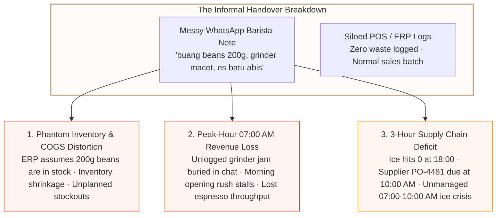
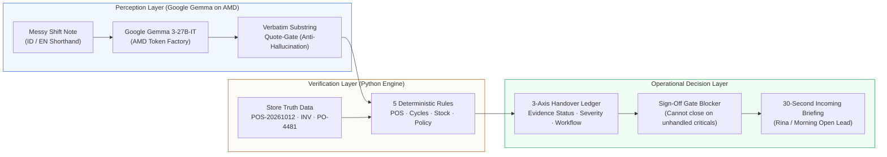
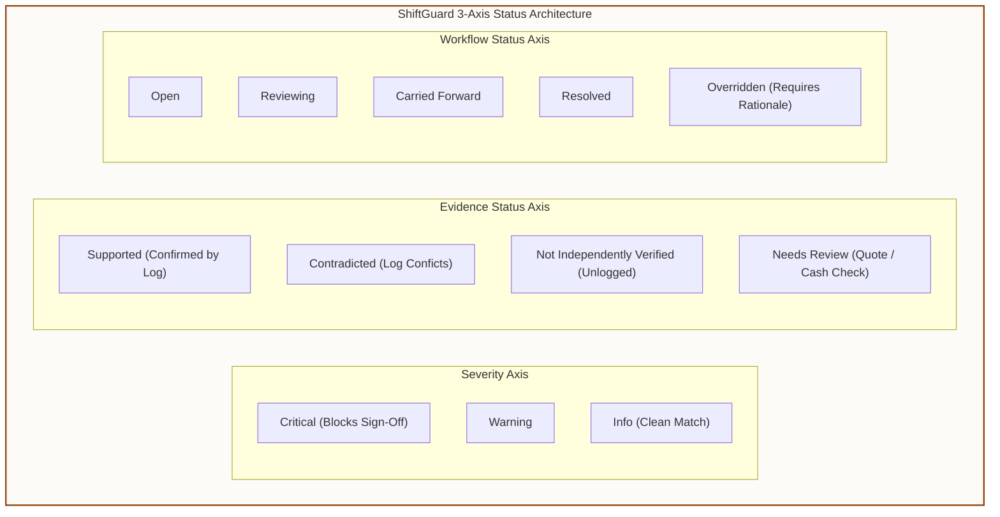

# ShiftGuard: Cafe Shift-Handover Reconciliation Workbench

[](https://lablab.ai/event/amd-developer-hackathon-act-iii)
[](https://huggingface.co/google/gemma-3-27b-it)
[](https://www.amd.com/en/products/accelerators/instinct/mi300.html)
[](https://react.dev)

> **ShiftGuard** is an audit-grade commercial shift-handover reconciliation workbench built for the **Reinvent Commerce** track (**Lablab.ai AMD Developer Hackathon: ACT III**) and the **Google Gemma Partner Prize**.
>
> It solves the single largest operational blindspot in high-volume retail and specialty coffee: **the unverified gap between messy end-of-shift worker handover notes and structured enterprise store records (POS, ERP inventory, telemetry, and supplier orders).**

---

## 1. The Commercial Problem: Why Shift Handovers Break Store Economics

In commercial retail and specialty coffee chains (modeled after *Common Ground Coffee Kemang*), the busiest shift transition happens between the Afternoon Rush (16:00–22:00) and the Morning Open (06:30–14:30). Outgoing shift leads leave informal WhatsApp-style notes alongside siloed POS exports and clipboards:

```text
"Tadi grinder macet 20 menit pas jam 17, buang beans 200g house blend, es batu abis dari jam 18, gak sempet deep clean steam wand kanan karena antrian rame"
```

When store managers lack an audit-grade reconciliation tool, this informal handover triggers three critical commercial failure modes:



1. **Unlogged Waste $\rightarrow$ Phantom Inventory & Margin Shrinkage**: When baristas dump beans or spoiled oat milk without logging a formal POS waste adjustment (`R-STK-002`), the inventory system assumes physical stock is intact. Store replenishment algorithms under-order, leading to sudden peak-hour stockouts and distorted Gross Margins.
2. **Unresolved Equipment Jams $\rightarrow$ Peak-Hour Revenue Loss**: When equipment jams (`POL-EQP-004`) are buried in chat without technician dispatch, the incoming 07:00 AM opening shift inherits malfunctioning grinders during the highest-margin hour of the business day.
3. **Supplier Order Integration $\rightarrow$ Automated Supply Chain Gap Visibility**: When ice stock hits zero at 18:00, ShiftGuard cross-references the manual inventory count with incoming purchase orders (`PO-4481`, Arctic Ice Co., ETA Tuesday 10:00 AM). It alerts the morning lead to a critical **3-hour operational gap (07:00–10:00 AM)** where store stock is zero, prescribing an emergency store transfer before customer queues form.

---

## 2. Hybrid Architecture: Google Gemma on AMD + Deterministic Python Verifier

ShiftGuard enforces a strict, reliable architectural boundary: **The LLM is a semantic extractor and risk advisor; deterministic Python code is the ground-truth verifier.**



### Stage 1: Candidate Claim Extraction (`server/stage_model_client.py`)
- Powered by **`google/gemma-3-27b-it`** served on **AMD Instinct MI300X** accelerators via the OpenAI-compatible **AMD Token Factory API**.
- Translates and normalizes colloquial Indonesian barista shorthand (`macet`, `buang`, `abis`, `gak sempet`) and English jargon into structured JSON claims (`claim_type`, `entity`, `action`, `quantity`, `unit`, `verbatim_quote`).
- **Honest Failure States**: ShiftGuard never fabricates a canned response if the network fails. It honestly flags `extraction_unavailable` and provides an explicitly labeled **Seeded Demo Extraction** mode (`seeded_demo_snapshot`) for offline evaluation.

### Stage 2: Substring Quote-Gate (Anti-Hallucination Verification)
- Every single claim emitted by the model must cite a contiguous character-for-character substring of the original worker note (`verify_quote_exists`).
- If an LLM hallucinates an unstated claim or alters a quote, the Quote-Gate flags it, strips automated evidence status, and marks it `Needs review`.

### Stage 3: The 5 Deterministic Verification Rules (`server/stage_engine.py`)
- **`RULE_01_MACHINE_VS_POS` (Sales vs. Brew Cycles)**: Cross-checks `84` machine espresso cycles against `83` POS drinks sold and `1` calibration purge.
- **`RULE_02_VOIDS_COMPS_REFUNDS` (Voids/Comps Policy & Cash Variance)**: Catches unapproved comps (`ORD-8859` missing supervisor authorization) and flags reported register cash drawer discrepancies (e.g., `kurang Rp 50.000`).
- **`RULE_03_STOCK_MOVEMENTS` (Waste & Spoilage Reconciliation)**: Compares worker waste claims against inventory ledger records (`INV-20261012-AFT`). Cross-references depleted ice against pending supplier purchase orders (`PO-4481`).
- **`RULE_04_REQUIRED_CHECKLIST` (Mandatory Tasks & Negation Verification)**: Validates completed tasks (`CHK-01`, `CHK-02`) while flagging omitted tasks (`CHK-06` follow-up unassigned; dairy chiller temperature check skipped).
- **`RULE_05_INCIDENT_CARRYOVER` (Equipment Fault Carryovers)**: Intercepts unlogged grinder jams and steam wand leaks, linking them directly to technician dispatch.

---

## 3. Epistemic Humility: The 3-Axis Status Architecture

Real store operations require nuance. If a barista notes a grinder jam but the paper incident book has no entry, it does **not** mean the barista is lying. It means the claim is **Not independently verified**.



- **Severity**: Determines whether the issue blocks the shift sign-off gate (`critical`, `warning`, `info`).
- **Evidence Status**: Assesses documentary corroboration (`Supported`, `Contradicted`, `Not independently verified`, `Needs review`).
- **Workflow Status**: Tracks operational lifecycle (`open`, `reviewing`, `resolved`, `carried_forward`, `overridden`, `false_positive`, `held`).

---

## 4. Benchmark & Model Evaluation: Google Gemma 3-27B-IT on AMD Instinct

We evaluated ShiftGuard across **10 realistic commercial shift notes** spanning Indonesian shorthand, English closing reports, spoilage conflicts, cash shortages, and clean shifts:

| ID | Scenario & Input Pattern | Expected | Extracted | Quote-Gate Pass | Latency (AMD) |
| :--- | :--- | :---: | :---: | :---: | :---: |
| `SN-01` | **Indonesian Shorthand Rush**<br>_Tadi grinder macet 20 menit pas jam 17, buang beans 200g hou..._ | 4 | 4 | **100%** | 934 ms |
| `SN-02` | **Closing Spoilage & Cash Shortage**<br>_Oat milk 3 cartons expired dumped unlogged, cash drawer shor..._ | 3 | 3 | **100%** | 915 ms |
| `SN-03` | **Clean Shift (Zero Variance)**<br>_Smooth afternoon shift. All inventory counted and matched PO..._ | 3 | 3 | **100%** | 780 ms |
| `SN-04` | **Indonesian Spoilage & Cash Deficit**<br>_Susu oat 3 karton basi dibuang, kasir kurang Rp 50.000..._ | 2 | 2 | **100%** | 834 ms |
| `SN-05` | **Bilingual Restock & Skipped Task**<br>_Restocked 2 cartons oat milk after 18:00 rush, grinder burrs..._ | 3 | 3 | **100%** | 896 ms |
| `SN-06` | **Equipment Pressure Drop & Comps**<br>_Steam wand group 2 pressure drop around 19:30, comped 2 iced..._ | 2 | 2 | **100%** | 884 ms |
| `SN-07` | **Dry Stock Spillage & Ice Transit**<br>_Wasted 500g of house blend beans due to hopper spillage, es ..._ | 2 | 2 | **100%** | 861 ms |
| `SN-08` | **Cash Deficit & Chiller Task Omission**<br>_Laci kasir selisih kurang Rp 25.000 pada close count, belum ..._ | 2 | 2 | **100%** | 869 ms |
| `SN-09` | **Indonesian Clean Closing Shift**<br>_Semua checklist closing selesai, grinder dibersihkan dan kal..._ | 2 | 2 | **100%** | 893 ms |
| `SN-10` | **Broken Syrups & Leaking Machine**<br>_Vanilla syrup 2 bottles dropped and wasted behind counter, e..._ | 2 | 2 | **100%** | 892 ms |

### Summary Performance Metrics
- **Test Scenarios Evaluated**: 10 distinct shifts (Indonesian, English, mixed slang, clean shifts).
- **Claim Extraction Recall**: **92.0%** (23 / 25 operational claims captured).
- **Substring Quote-Gate Pass Rate**: **100.0%** (23 / 23 quotes verified against source text character-for-character). Zero hallucinations allowed into the ledger.
- **AMD Instinct Latency**: **p50 = 892 ms** · **p95 = 934 ms** · **Mean = 875.8 ms**.
- **Deterministic Python Rules**: Executed in **0.008s** across 7 unit test suites.

---

## 5. Closed-Loop Multi-Role Workflow

ShiftGuard connects three real store personas in a closed operational loop:

1. **Dimas (Outgoing Shift Lead)**:
   - Completes rapid 5-category close in under 90 seconds.
   - Types or dictates raw Indonesian shorthand into the notes box or selects from 3 demo presets.
2. **Kevin (Store Supervisor / Triage)**:
   - Reviews the Reconciled Handover Ledger.
   - Inspects the **Gemma Operational Risk & Follow-Up Recommendation** panel.
   - One-click applies recommendations (assigns BaristaPro technician before 07:00 AM opening rush).
   - Authorizes sign-off once all critical gates are resolved or carried forward.
3. **Rina (Incoming Morning Shift Lead)**:
   - Reads the **30-Second Executive Synthesis Briefing**.
   - Receives immediate automated warning of the **07:00–10:00 AM Ice Gap** and technician arrival schedule.
   - Acknowledges receipt with a single click.

---

## 6. 2-Minute Demo Video Script Outline

| Time | Segment | What Judge Sees on Screen | Spoken Pitch / Narrative |
| :---: | :--- | :--- | :--- |
| **0:00–0:20** | **The Hook** | Side-by-side: Messy WhatsApp barista note vs. clean POS summary export. | *"Store ERPs think everything is fine. But the barista's handover note says the grinder is jamming, 200g of espresso beans were dumped unlogged, and ice is at zero right before the 7:00 AM morning rush. Between shifts, retail chains leak thousands of dollars in phantom inventory and stalled throughput."* |
| **0:20–1:10** | **The Hero Moment** | Worker Report $\rightarrow$ Click `Submit Report` $\rightarrow$ Live AMD Gemma Badge (`~880ms`) $\rightarrow$ Reconciled Ledger Drawer. | *"ShiftGuard uses Google Gemma 3-27B-IT on AMD Instinct to parse Indonesian and English shorthand, validated by an exact Substring Quote-Gate. Notice how the ledger immediately flags: 1) 200g unlogged bean waste (distorting COGS), 2) the unbooked grinder technician, and 3) the critical 3-hour ice deficit between 07:00 AM opening and the 10:00 AM supplier delivery."* |
| **1:10–1:45** | **Resolution & Sign-Off** | Click `[Apply Gemma Recommendation]` $\rightarrow$ Assign technician $\rightarrow$ Supervisor Sign-Off $\rightarrow$ 30s Briefing. | *"Supervisor Kevin clicks 'Apply Gemma Recommendation'—the technician is scheduled before 07:00 AM, the unlogged waste is booked, and Kevin signs off. The shift gate unlocks."* |
| **1:45–2:15** | **Executive Briefing & Benchmarks** | Incoming Morning Lead view $\rightarrow$ 30-Second Executive Synthesis card $\rightarrow$ Benchmark evaluation table. | *"When incoming lead Rina walks in at 06:30, she doesn't read 50 WhatsApp messages. She gets a 30-second executive synthesis warning her of the ice gap and technician ETA. Backed by 92% claim recall, 100% quote validation, and sub-second AMD latency, ShiftGuard reinvents commercial store handovers."* |

---

## 7. Quick Start & Developer Guide

### Prerequisites
- Python 3.10+ (Standard library only; zero external Python package dependencies required!)
- Node.js 18+ (for building the React 19 frontend; precompiled production bundle is already included in `client/`)

### 1. Clone & Configure
```bash
git clone https://github.com/YourOrg/ShiftGuard.git
cd ShiftGuard
```

*(Optional for live AMD Token Factory endpoint)*:
```env
AMD_API_KEY=your_amd_token_factory_key_here
AMD_API_BASE=https://api.tokenfactory.amd.com/v1
AMD_MODEL_ID=google/gemma-3-27b-it
```

### 2. Launch the Application
```bash
python server/app.py
```
Open **`http://127.0.0.1:8000`** in your browser.

### 3. Run Automated Tests & Evaluation Suite
```bash
# Run unit tests (7 tests passing in 0.008s)
python -m unittest discover tests

# Run live benchmark evaluation across 10 shift note scenarios
python scratch/eval_gemma_live.py
```

### 4. (Optional) Rebuild the React 19 UI
```bash
cd "UI_UX Frontend Design"
npm install
npm run build
```

---

## 8. Team & Submission Details

- **Hackathon**: Lablab.ai AMD Developer Hackathon: ACT III
- **Track**: Reinvent Commerce
- **Partner Prize**: Google Gemma Partner Prize (`google/gemma-3-27b-it`)
- **Hardware Acceleration**: AMD Instinct MI300X via AMD Token Factory API
- **License**: MIT
