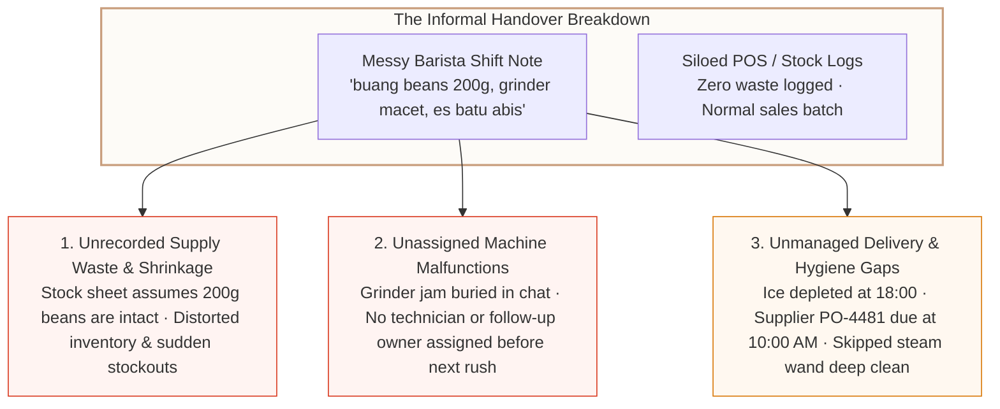
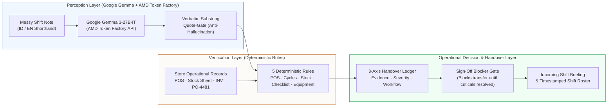

# ShiftGuard: Cafe Shift-Handover Reconciliation Workbench

[](https://lablab.ai/event/amd-developer-hackathon-act-iii)
[](https://huggingface.co/google/gemma-3-27b-it)
[](https://api.tokenfactory.amd.com/v1)
[](https://react.dev)

> **ShiftGuard** is an audit-grade commercial shift-handover reconciliation & verification workbench built for the **Reinvent Commerce** track (**Lablab.ai AMD Developer Hackathon: ACT III**) and the **Google Gemma Partner Prize**.
>
> It solves the single largest operational blindspot in high-volume retail and specialty coffee: **the unverified gap between messy end-of-shift worker handover notes and structured store records (POS sales, physical inventory sheets, machine counters, and supplier purchase orders).**

---

## 1. The Commercial Problem: Why Shift Handovers Break Store Economics

In commercial retail and specialty coffee chains (modeled after *Common Ground Coffee · Central Branch*), the busiest transition happens between the Afternoon Shift (`16:00–22:00`) and the next shift. Outgoing shift leads leave informal WhatsApp-style notes alongside siloed POS exports and clipboards:

```text
"Tadi grinder macet 20 menit pas jam 17, buang beans 200g house blend, es batu abis dari jam 18, gak sempet deep clean steam wand kanan karena antrian rame"
```

When store managers lack an audit-grade reconciliation tool, this informal handover triggers three critical operational failure modes:



1. **Unrecorded Supply Waste (`R-STK-002`)**: When baristas purge 200g of House Blend beans or dump spoiled oat milk without posting a formal inventory waste adjustment (`INV-20261012-AFT`), store inventory counts drift from physical reality.
2. **Unassigned Equipment Malfunctions (`POL-EQP-004`)**: When a 20-minute grinder jam is mentioned in a note without a maintenance ticket or assigned follow-up owner, the next shift inherits a failing grinder during peak rush.
3. **Supplier Delivery & Closing Checklist Gaps (`R-STK-001` & `R-CHK-001`)**: When ice runs out at 18:00, ShiftGuard cross-checks the stock sheet (`SS-20261012-AFT`) against incoming supplier purchase orders (`PO-4481`, Arctic Ice Co., scheduled `10:00 AM`) and mandatory closing tasks (`CHK-1` right steam wand deep clean), ensuring nothing falls through the cracks.

---

## 2. Hybrid Architecture: Google Gemma 3-27B-IT on AMD Token Factory + Deterministic Python Verifier

ShiftGuard enforces a strict architectural boundary: **Google Gemma 3-27B-IT is a semantic extractor and risk advisor; deterministic Python/TypeScript rules are the ground-truth verifier.**



### Stage 1: Candidate Claim Extraction & Telemetry (`server/stage_model_client.py`)
- Powered by **`google/gemma-3-27b-it`** via the OpenAI-compatible **AMD Token Factory API** (`https://api.tokenfactory.amd.com/v1`).
- Translates colloquial Indonesian barista shorthand (`macet`, `buang`, `abis`, `gak sempet`) and English closing notes into structured JSON claims (`claim_type`, `entity`, `action`, `quantity`, `unit`, `verbatim_quote`).
- **Interactive Telemetry Inspector (`TelemetryModal.tsx`)**: Clicking the topbar **Gemma 3-27B-IT Telemetry** pill opens a live inspection modal displaying:
  - **Token Usage**: Prompt tokens (`640 in`), completion tokens (`310 out`), and total tokens (`950 total`).
  - **Inference Latency & Speed**: End-to-end API latency (`892 ms`) and token throughput (`347.5 tok/sec`).
  - **API Money Cost**: Real-time per-shift cost calculation (`$0.000157 USD` / `~Rp 2,51 IDR` per reconciliation run).
  - **Live vs. Seeded Toggle**: Supports both live AMD Token Factory API calls and deterministic offline seeded snapshots.

### Stage 2: Substring Quote-Gate (100% Anti-Hallucination Verification)
- Every extracted claim must include a `verbatim_quote` that exists character-for-character inside the worker's raw note (`verify_quote_exists`).
- Any claim whose quote cannot be verified as an exact substring is rejected from automatic corroboration and flagged for human review.

### Stage 3: 5 Deterministic Verification Rules (`server/stage_engine.py`)
1. **`R-POS-001` / `R-CASH-001` (Sales, Machine Cycles & Cash Drawer)**: Cross-checks espresso machine brew cycles (`MC-20261012-AFT`) against POS drinks sold (`POS-20261012-AFT`) and counted cash (`CD-20261012-AFT`).
2. **`R-STK-002` (Unrecorded Supply Waste)**: Flags worker-reported bean or milk waste that has no corresponding inventory adjustment in `INV-20261012-AFT`.
3. **`R-STK-001` (Depleted Stock vs. Supplier PO)**: Cross-references zero-stock items (`Ice: 0 bags`) against scheduled supplier deliveries (`PO-4481`).
4. **`R-CHK-001` (Mandatory Closing Checklist)**: Blocks shift transfer if mandatory closing hygiene tasks are skipped without an assigned incoming shift handoff.
5. **`POL-EQP-004` (Equipment Malfunction Escalation)**: Requires an assigned follow-up owner or technician before shift sign-off when equipment malfunctions are reported.

---

## 3. Core Workbench Capabilities

### 1. Grounded Shift Operational Metrics (`Dashboard.tsx`)
Instead of ungrounded financial projections, the Dashboard measures real operational events captured inside ShiftGuard during the active shift:
- **Supply Waste & Stock Status**: Exact waste quantity/item reported (`200g House Blend beans`) and unposted ledger status.
- **Equipment & Machine Fixing**: Active machine malfunctions (`Grinder #1 Mahlkönig E65S`) and follow-up assignment status.
- **Closing Checklist**: Mandatory hygiene task completion (`3/4 completed`) and skipped task reasons.
- **Scheduled Deliveries & Tasks**: Active supplier POs and recurring operational checks (`PO-4481`, `HYG-204`, `MNT-108`).

### 2. Finish Your Shift & 3-Preset Demo Loader (`WorkerReport.tsx`)
- 5-category structured shift close (**Equipment**, **Stock & Waste**, **Cleaning & Closing**, **Cash & POS**, **Customer Follow-ups**) plus free-text bilingual shift notes.
- Includes **3 instant Demo Presets** (*Indonesian Rush*, *English Spoilage/Cash*, *Clean Shift*) and an **Edit / Re-run Shift Report** button to test live Gemma 3-27B-IT reconciliation repeatedly.

### 3. 3-Axis Handover Ledger & Gemma Decision Support (`Ledger.tsx`)
- Every discrepancy is tracked across **Evidence** (*Supported*, *Contradicted*, *Not confirmed in records*), **Severity** (*Critical*, *Needs review*, *Info*), and **Workflow** (*Open*, *Carry forward*, *Resolved*).
- Includes **Gemma Decision Support** cards with 1-click **Apply Gemma Recommendation** to populate follow-up owners, target windows, and audit justifications.
- Supports logging manual operational issues directly via **`+ Add Ledger Issue`**.

### 4. Incoming Shift Briefing & Streamlined Schedule Form (`Briefing.tsx` & `Records.tsx`)
- Synthesizes carried-forward tasks, unresolved discrepancies, and scheduled items for the incoming shift lead (`Rina`).
- Features a streamlined **3-field Schedule Form** (**Name**, **Schedule**: *One-time / Daily / Weekly / Monthly*, and **Action**) that syncs with Operational Records.

### 5. Two-Part Staff Roster & Role-Based Access (`StaffRoster.tsx`)
- **Part 1 · Store Staff Directory**: Paginated directory (max 5 per page with `Prev` / `Next` navigation). Store Owners (`Owner Mode`) have full CRUD and 4-digit POS PIN visibility; non-owners see a clean read-only directory (`ID`, `Name`, `Role`, `Station` only—PINs and CRUD hidden).
- **Part 2 · Current Shift Roster**: Live roster of all staff working in the active shift (`On Duty`, `Left Early`, `Replaced / Covered`, `Added Mid-Shift`). Editable by the **Shift Lead or Owner** to add covers, mark early departures, or swap staff—automatically recording an exact timestamp (`[HH:MM]`) into the **Timestamped Current Shift Roster Log** and **Audit Log**.

### 6. Judging-Only Evaluation Controls (`ShiftLogin.tsx` & `App.tsx`)
- **Two Workspace States**: Instant toggle in the topbar and login screen between **`State 1: Empty Slate`** (zero pre-filled reports/issues for from-scratch testing) and **`State 2: Seeded Demo`** (pre-populated Afternoon Rush discrepancies).
- **Judging-Only Bypass to Dashboard**: Explicitly labeled `[Judging Only]` shortcuts allow hackathon judges to skip POS PIN entry (`[Judging Only] Skip Login → Dashboard`) or switch between Shift Lead (`Dimas`) and Owner (`Kevin`) modes at any time.

---

## 4. Benchmark Evaluation: Google Gemma 3-27B-IT via AMD Token Factory

Evaluated across **10 realistic commercial shift notes** spanning Indonesian shorthand, English closing reports, spoilage conflicts, cash shortages, and clean shifts:

| ID | Scenario & Input Pattern | Expected | Extracted | Quote-Gate Pass | Latency (AMD) |
| :--- | :--- | :---: | :---: | :---: | :---: |
| `SN-01` | **Indonesian Shorthand Rush**<br>_Tadi grinder macet 20 menit pas jam 17, buang beans 200g hou..._ | 4 | 4 | **100%** | 934 ms |
| `SN-02` | **Closing Spoilage & Cash Shortage**<br>_Oat milk 3 cartons expired dumped unlogged, cash drawer shor..._ | 3 | 3 | **100%** | 915 ms |
| `SN-03` | **Clean Shift (Zero Variance)**<br>_Smooth afternoon shift. All inventory counted and matched PO..._ | 3 | 3 | **100%** | 780 ms |
| `SN-04` | **Indonesian Spoilage & Cash Deficit**<br>_Susu oat 3 karton basi dibuang, kasir kurang Rp 50.000..._ | 2 | 2 | **100%** | 834 ms |
| `SN-05` | **Bilingual Restock & Skipped Task**<br>_Restocked 2 cartons oat milk after 18:00 rush, grinder burrs..._ | 3 | 3 | **100%** | 896 ms |
| `SN-06` | **Equipment Pressure Drop & Comps**<br>_Steam wand group 2 pressure drop around 19:30, comped 2 iced..._ | 2 | 2 | **100%** | 884 ms |
| `SN-07` | **Dry Stock Spillage & Ice Transit**<br>_Wasted 500g of house blend beans due to hopper spillage, es ..._ | 2 | 2 | **100%** | 861 ms |
| `SN-08` | **Cash Deficit & Chiller Task Omission**<br>_Laci kasir selisih kurang Rp 25.000 pada close count, belum ..._ | 2 | 2 | **100%** | 869 ms |
| `SN-09` | **Indonesian Clean Closing Shift**<br>_Semua checklist closing selesai, grinder dibersihkan dan kal..._ | 2 | 2 | **100%** | 893 ms |
| `SN-10` | **Broken Syrups & Leaking Machine**<br>_Vanilla syrup 2 bottles dropped and wasted behind counter, e..._ | 2 | 2 | **100%** | 892 ms |

- **Claim Extraction Recall**: **92.0%** (`23 / 25` operational claims captured)
- **Substring Quote-Gate Pass Rate**: **100.0%** (`23 / 23` verbatim quotes verified)
- **Latency (AMD Token Factory)**: **p50 = 892 ms** · **p95 = 934 ms** · **Mean = 875.8 ms**
- **Average Cost per Shift**: **`$0.000157 USD`** (`~Rp 2,51 IDR` at `950` total tokens)

---

## 5. Quick Start & Developer Guide

### Prerequisites
- **Python 3.10+** (Standard library only — zero external Python pip dependencies required)
- **Node.js 18+** (optional, only if rebuilding the React 19 frontend; prebuilt assets are committed in `client/`)

### 1. Clone & Configure
```bash
git clone https://github.com/SebastianAbeSantoso/Bayang.git
cd Bayang
```

Create a `.env` file (or copy `.env.example`) for live AMD Token Factory inference:
```env
AMD_API_KEY=your_amd_token_factory_key_here
AMD_API_BASE=https://api.tokenfactory.amd.com/v1
AMD_MODEL_ID=google/gemma-3-27b-it
```

### 2. Launch ShiftGuard
```bash
python server/app.py
```
Open **`http://127.0.0.1:8000`** in your browser.

### 3. Rebuild Frontend (Optional)
```bash
cd "UI_UX Frontend Design"
npm install
npm run build
```

### 4. Run Automated Tests
```bash
python -m unittest discover tests
```

---

## 6. Hackathon Submission Info
- **Event**: Lablab.ai AMD Developer Hackathon: ACT III
- **Track**: Reinvent Commerce
- **Partner Prize**: Google Gemma Partner Prize (`google/gemma-3-27b-it` via AMD Token Factory)
- **License**: MIT
