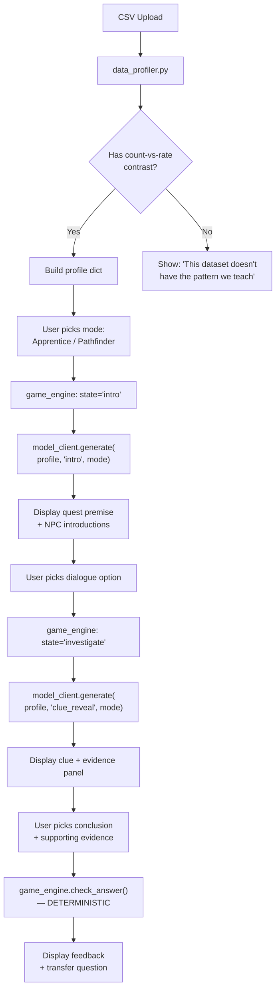

# Bayang — Full Project Evaluation & Advice

**Date:** 13 October 2026, evening  
**Deadline:** 18 October 2026, 15:00 UTC (~5 days from now)  
**Current state:** Concept + Implementation Plan only. Zero code written.

---

## 1. Honest Assessment: What You Have

You have **three strong documents** and **zero running software**. The concept is well-scoped, the plan is realistic, and the README is clean. That's genuinely better than most hackathon starting points — most people write bad plans and good code. You've done the reverse, and now you need to flip.

### What's good about the idea

| Strength | Why it matters |
|---|---|
| **Narrow, teachable concept** | "Counts vs. rates" is a real cognitive trap. You picked one lesson and committed — judges love that. |
| **Deterministic core + generative shell** | The split between "app checks the math, model tells the story" is the right architecture. It's defensible, explainable, and avoids the "the LLM hallucinated wrong answers" trap. |
| **Data-driven generation** | Two different CSVs → two different quests is a strong demo beat. It proves the system is generative, not scripted. |
| **Track fit** | "New Kind of Experience" is the softest track — it rewards novelty and polish over raw infra feats. A fantasy RPG investigation is the right vibe. |
| **Clear buyer hypothesis** | "Bootcamps want short applied exercises" is credible and not over-claimed. |

### What's risky

| Risk | Severity | Notes |
|---|---|---|
| **AMD credit hasn't arrived yet** | 🔴 Critical | Your entire Phase B depends on this. No credit = no AMD inference = no prize eligibility. You cannot control this. |
| **5 days, solo, zero code** | 🔴 Critical | You need a working prototype with frontend, backend, CSV pipeline, prompt engineering, and AMD integration. |
| **RPG UX scope creep** | 🟡 Medium | "Characters, dialogue choices, clues, investigation" can expand infinitely. You need to ruthlessly cut to what you can build. |
| **Prompt engineering unknown** | 🟡 Medium | You haven't tested whether an open-weight model (likely Llama 3.x 8B–70B) can reliably produce structured quest output from a data profile. This is a "find out by doing" problem. |
| **SVG chart from scratch** | 🟢 Low | You said "inline SVG" but you could use a tiny charting library and save hours. |

---

## 2. Core Strategic Advice

### Build backwards from the demo, not forwards from the plan

Your plan is phased like a product roadmap (A → B → C → D). You don't have time for that. Instead:

> **Define the exact 3-minute demo you want to show, then build only what that demo needs.**

Here is the demo script that wins:

1. *(15 sec)* Title screen. "Bayang: The Vanishing Caravans." Explain the pitch in one sentence.
2. *(20 sec)* Upload a CSV. Show the data profile (groups, counts, rates).
3. *(15 sec)* Pick "Apprentice" mode.
4. *(60 sec)* Play through 2–3 dialogue choices. Show the AMD model generating the quest text live. Show the NPC giving a clue. Show the count/rate evidence panel.
5. *(30 sec)* Make a conclusion choice. Get feedback. See the transfer question.
6. *(20 sec)* Now upload a *different* CSV. Show the quest regenerating with different characters/setting.
7. *(15 sec)* Switch to "Pathfinder" mode. Show the reduced guidance.
8. *(15 sec)* Show the latency, token count, and AMD GPU info.

**Total: ~3 minutes.** Everything you build should serve this script. Anything that doesn't is cut.

### Don't polish what nobody will see

- Nobody will upload a weird CSV during judging. Your validation can be basic.
- Nobody will play for 20 minutes. 3–4 interaction beats is enough.
- Nobody will inspect your SVG on mobile. Desktop-only is fine.

---

## 3. What to Build and In What Order

Here is my recommended build sequence, re-ordered for maximum "demoable at any point" safety:

### Tonight (Oct 13): Skeleton that runs

**Goal:** A browser page that loads, shows a CSV, and displays quest text.

1. Create the project structure:
   ```
   Bayang/
   ├── server/
   │   ├── app.py              # Python HTTP server
   │   ├── data_profiler.py    # CSV → profile dict
   │   ├── game_engine.py      # State machine for the quest
   │   └── model_client.py     # One function: generate(prompt) → text
   ├── client/
   │   ├── index.html
   │   ├── style.css
   │   └── app.js
   ├── data/
   │   ├── caravans_a.csv
   │   └── caravans_b.csv
   ├── prompts/
   │   └── gamemaster.txt      # System prompt template
   └── requirements.txt        # (maybe just `aiohttp` or nothing)
   ```

2. Write `data_profiler.py` first. It's pure logic, no dependencies, instantly testable:
   - Read CSV with `csv` module
   - Validate headers: `group`, `events`, `opportunities` (or whatever you name them)
   - Compute rates, find the count-vs-rate contrast
   - Return a clean dict

3. Write `model_client.py` with a **dual-mode interface**:
   ```python
   def generate(profile: dict, scene: str, mode: str) -> str:
       if os.environ.get("AMD_ENDPOINT"):
           return _call_amd_vllm(profile, scene, mode)
       else:
           return _template_fallback(profile, scene, mode)
   ```
   The template fallback is your safety net. If AMD credit never arrives, you still have a working demo (just less impressive).

4. Write `app.py` — a minimal Python HTTP server (~100 lines). Serve static files, handle `/api/upload`, `/api/generate`, `/api/check_answer`.

5. Write `index.html` — a single page with sections that show/hide. No router, no framework. Sections: Landing → Upload → Profile → Quest → Evidence → Conclusion → Transfer.

> [!IMPORTANT]
> **Do NOT build the SVG chart from scratch.** Use a `<table>` with colored bars via CSS `width` percentages, or use [Chart.css](https://chartscss.org/) — it's a CSS-only charting library, zero JS, zero build step. You'll save 2+ hours.

### Oct 14: Game loop works end-to-end

**Goal:** You can click through the entire quest flow with template text.

1. Implement `game_engine.py` as a simple state machine:
   ```python
   STATES = ["intro", "investigate", "evidence", "conclude", "transfer"]
   ```
   Each state has: a prompt template for the model, valid player actions, and a transition rule. This is your "the app controls game logic" guarantee.

2. Wire up 2–3 dialogue choices per scene. Keep it shallow:
   - **Intro:** Read the quest premise. Click "Begin investigation."
   - **Investigate:** Choose which NPC to question (2 choices). Each reveals a clue.
   - **Evidence:** View the count/rate comparison. The Apprentice mode highlights the discrepancy; Pathfinder just shows the numbers.
   - **Conclude:** Pick "Route A is more dangerous" or "Route B is more dangerous" + pick your evidence (count or rate). The app checks deterministically.
   - **Transfer:** One new mini-scenario. Same structure.

3. Build both sample CSVs and verify the profiler handles them.

4. Test the full flow in template mode. **Record a screen capture.** If everything goes wrong with AMD, this is your backup demo.

### Oct 15–16: AMD Integration (when credit arrives)

**Goal:** Replace template text with live model generation.

1. **The moment credit arrives:**
   - Identify GPU type (likely MI300X)
   - Pick model: **Llama 3.1 8B Instruct** is the safe choice (fits easily, fast inference, good instruction following). Go 70B only if you get a big GPU and have time to test.
   - Launch vLLM: `python -m vllm.entrypoints.openai.api_server --model meta-llama/Llama-3.1-8B-Instruct --port 8000`
   - Test with a curl request immediately.

2. Write the game master system prompt. This is the most important piece of prompt engineering:

   ```
   You are the game master for Bayang, a fantasy investigation quest.
   You will receive a DATA PROFILE and a SCENE INSTRUCTION.
   
   DATA PROFILE contains verified facts: group names, event counts,
   opportunity counts, and calculated rates. These numbers are TRUE.
   You must not invent, alter, or contradict any number.
   
   Your job is to wrap these facts in an engaging fantasy narrative.
   Generate: a quest premise, NPC names and dialogue, and clues
   that point to the real data.
   
   RULES:
   - Never state a number that contradicts the profile.
   - Never reveal the analytical conclusion directly.
   - Respond in the persona of a tabletop RPG game master.
   - Keep responses under 200 words.
   - Output valid JSON matching the provided schema.
   ```

   > [!TIP]
   > **Ask for structured JSON output.** This is critical. If the model returns free-form text, you can't reliably parse character names, clues, etc. Use a JSON schema in the prompt and validate the response. vLLM supports guided decoding / JSON mode — use it if available for your model.

3. Test with both datasets. Verify the model doesn't hallucinate numbers. If it does, tighten the prompt or reduce what you ask it to generate.

4. **Measure and save:** response time, token counts, which model, which GPU. You need these for the submission.

### Oct 17: Polish and record

- End-to-end test both datasets, both modes
- Add loading spinners for model calls
- Add error handling if the model endpoint is down
- Clean up the UI (doesn't need to be beautiful — needs to be *clear*)
- Record the demo video
- Update README with exact run instructions

### Oct 18: Submit

- Final check that the repo is clean
- README has: setup steps, env vars, architecture diagram, AMD role explanation
- Submit on lablab.ai before 15:00 UTC

---

## 4. Deeper Mechanics: How Bayang Actually Works

Let me lay out the internal flow more precisely than the concept doc does, because this is what you'll need to implement:



### The data profile dict

This is the contract between your profiler and everything else:

```python
{
    "groups": [
        {
            "name": "North Road",
            "events": 12,
            "opportunities": 300,
            "rate": 0.04,
            "rate_display": "4.0%"
        },
        {
            "name": "Marsh Road",
            "events": 4,
            "opportunities": 40,
            "rate": 0.10,
            "rate_display": "10.0%"
        }
    ],
    "highest_count_group": "North Road",
    "highest_rate_group": "Marsh Road",
    "pattern": "count_vs_rate",
    "insight": "The group with the most events is NOT the group with the highest rate."
}
```

Define this early. Everything depends on it.

### The mode difference

Don't overcomplicate this. Here's the minimum viable difference:

| Aspect | Apprentice | Pathfinder |
|---|---|---|
| Evidence panel | Shows "Notice: North Road has more losses, but Marsh Road has a higher *rate*" | Shows just the numbers, no callout |
| NPC dialogue | NPC says "Have you considered looking at losses *per trip*?" | NPC says "The records are all there if you look carefully." |
| Conclusion screen | Pre-selects the correct framing, asks user to confirm | User must pick from scratch |
| Prompt modifier | `"The player is a beginner. Give explicit hints."` | `"The player prefers to discover things independently. Be subtle."` |

That's it. Same quest, same data, same flow — different hint density. Judges will see the difference in a side-by-side.

---

## 5. Track-Specific Advice: "New Kind of Experience"

The track brief asks for:

1. **An adaptive experience** — ✅ You have two modes + data-driven generation
2. **Demonstration across at least two audiences, situations, or inputs** — ✅ Two datasets, two modes

### What judges will look for

Based on "New Experience" track norms:

- **"Is this actually a new kind of experience, or is it a chatbot with a skin?"** → Your deterministic game engine + RPG structure + data-driven generation makes it genuinely different from a chatbot. **Lean into this in your pitch.** Say: *"The model doesn't decide what's true. The data does. The model just makes it feel like an adventure."*

- **"Does the AI make the experience fundamentally better?"** → Yes: different datasets produce different quests. Without the AI, you'd need to hand-write every quest. **Show the two-dataset comparison prominently.**

- **"Is it polished enough to imagine someone using it?"** → This is where most hackathon projects fail. You don't need pixel-perfect design, but you need:
  - Clear visual hierarchy (quest text is big, controls are obvious)
  - No layout glitches during the demo
  - Loading states when waiting for the model
  - A satisfying conclusion moment

### What NOT to spend time on

- ❌ CSV upload validation edge cases (malformed files, huge files, Unicode issues)
- ❌ Mobile responsiveness
- ❌ Multiple analytics skills beyond count-vs-rate
- ❌ Persistent sessions or accounts
- ❌ Elaborate character art or animations
- ❌ Free-form chat with the game master

---

## 6. The AMD Credit Problem

> [!CAUTION]
> This is your single biggest risk. If AMD credits don't arrive by Oct 15 evening, you are in serious trouble.

### What to do right now

1. **Check your email and the lablab.ai dashboard immediately** for any AMD Developer Cloud access instructions.
2. If you don't have them, **post in the hackathon Discord/community asking about credit distribution timeline.** Other participants will have the same question.
3. **Do NOT wait passively.** Build everything with the template fallback so your demo works regardless.

### If credit arrives late (Oct 16–17)

- Skip elaborate prompt engineering. Use one well-tested system prompt.
- Use the smallest viable model (8B) for fast iteration.
- Get one end-to-end AMD inference working and record it immediately as proof.

### If credit never arrives

- Your template fallback is the demo. Be honest: "We designed this for AMD inference, built the integration, but credit wasn't available in time. Here's the template-driven version and here's our integration code."
- You'll likely lose prize eligibility but can still submit as a portfolio piece.

---

## 7. Things You Should NOT Do

| Temptation | Why to resist |
|---|---|
| Build a chat interface | You're not building a chatbot. You're building a guided quest. Chat adds complexity and reduces the RPG feel. |
| Use React/Vue/Next.js | Zero benefit for a 5-page flow with show/hide sections. Vanilla JS + fetch is faster to build and debug. |
| Write a database layer | In-memory session state is correct. A database would waste a day. |
| Fine-tune a model | The plan correctly excludes this. Inference-only is the right call. |
| Add more analytics lessons | One lesson, well-demonstrated, beats three half-built ones. |
| Make the SVG interactive and animated | A clear, static comparison table/chart is worth more than a buggy animated one. |

---

## 8. Immediate Next Steps (Tonight)

Here's your checklist for the next 3 hours:

- [ ] Create the project folder structure shown in Section 3
- [ ] Write and test `data_profiler.py` with the two sample CSVs
- [ ] Write the `model_client.py` dual-mode interface (template + AMD stub)
- [ ] Write a minimal `app.py` that serves `index.html` and handles `/api/upload`
- [ ] Create `index.html` with the section layout (landing, upload, profile, quest, evidence, conclusion)
- [ ] Verify you can upload a CSV and see the profile in the browser
- [ ] Check lablab.ai / email for AMD credit status

> [!IMPORTANT]
> **The single most important thing is to have a runnable app by the end of tomorrow (Oct 14).** Even if it's ugly, even if the text is templated, even if there are only 2 dialogue choices. A running ugly app beats a perfect plan every time in a hackathon.

---

## 9. One More Thing: The Name

"Bayang" (shadow/reflection in Filipino/Malay) is a strong name for a data analytics tool about looking beneath surface numbers to find the real pattern. If judges ask about the name, have that one-liner ready.

---

**Bottom line:** The concept is sharp, the plan is sound, and the scope is right. Your only enemy now is time. Stop planning. Start coding. Build the ugliest working version first, then make it presentable.
